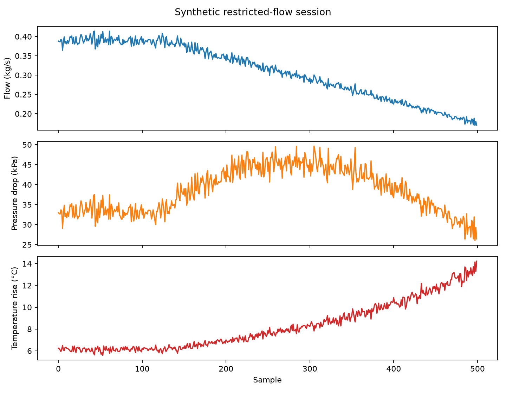

# Sensor Stream Simulator

A reproducible generator for **synthetic** cooling-loop sensor measurements.
The data is intended for software testing and engineering education; it is not
collected from physical equipment.

## Why I built it

I built this project while preparing to study mechanical engineering at Case
Western Reserve University. I wanted to understand how physical relationships,
random variation, anomalies, file formats, and automated tests fit together in
an engineering software project.

## Features

- Eight modes: normal operation, gradual temperature increase, restricted flow,
  pressure-drop increase, sensor drift, random missing measurements, pump
  failure, and leak event
- Configurable sample count, interval, random seed, and ISO 8601 start time
- CSV and JSON output
- Scenario and ground-truth anomaly labels in every row
- A clearly named `synthetic_heat_load_w` model input in every output row
- Coupled flow, pump, resistance, pressure-loss, and temperature relationships
- Fixed default start time and seeded randomness for full reproducibility
- Committed example datasets and a matplotlib plotting script

## Technical approach

The simulator uses Python's standard `random.Random` class with a local seeded
generator. Each scenario first sets pump speed, relative hydraulic resistance,
synthetic heat load, and any downstream delivery loss. The generator then
calculates flow, pressure drop, and outlet temperature in that order. This keeps
the reported pump, flow, and pressure values tied to one simplified model.

The core relationships are:

```text
flow = 0.39 kg/s × (pump speed / 60%) × downstream delivery fraction
       / sqrt(relative resistance) × (1 + seeded flow noise)

pressure drop = 35 kPa × relative resistance × (flow / 0.39 kg/s)²

temperature rise = synthetic_heat_load_w / (flow × 4180 J/(kg·K))
```

Relative resistance is 1.0 in normal operation. Restricted-flow and
pressure-drop-increase scenarios raise it; their synthetic pump controller also
raises pump speed. Pump failure reduces commanded pump speed and the imposed
heat load. The leak scenario reduces the fraction of flow delivered past the
modeled leak location and lowers inlet pressure.

`synthetic_heat_load_w` is an imposed ground-truth value created by the model.
It is not measured electrical power, a calibrated sensor reading, or evidence
from real cooling equipment. The relationships above are intentionally
simplified and are not a pump curve, hydraulic solver, or complete physical
model.

## Installation

### C++20 streaming simulator

The standalone C++ version requires CMake 3.20+ and a C++20 compiler. It uses
only the standard library. Build and run its automated tests:

```bash
cmake -S . -B build -DCMAKE_BUILD_TYPE=Debug -DCMAKE_CXX_COMPILER=clang++
cmake --build build --parallel 2
ctest --test-dir build --output-on-failure
./build/sensor_simulator --frames 10000 --capacity 16
./build/sensor_simulator --frames 10000 --capacity 4 --consumer-us 100 --drop-on-full
```

A producer generates synthetic temperature, pressure, and flow frames with a
zero-based sequence number and simulated elapsed time in seconds. Each frame
advances sample time by 1 ms; `--producer-us` controls wall-clock pacing
independently. `--consumer-us` simulates processing latency. Both delays default
to zero, and frame values are deterministic functions of sequence number.
These illustrative signals do not implement the Python cooling-loop scenarios.

Frames pass through a thread-safe, fixed-capacity ring buffer. The default
policy blocks the producer when full. `--drop-on-full` rejects the newest frame
instead; accepted frames retain their original sequence numbers, so gaps show
loss. Drop counts depend on thread scheduling. Closing the queue wakes blocked
readers and writers and drains accepted frames before shutdown.

The program prints produced, enqueued, consumed, dropped, currently queued, and
queue high-watermark counts, followed by the last consumed frame. After a run,
`produced = enqueued + dropped`, `enqueued = consumed`, and `queued = 0`.
Queue storage remains bounded by `--capacity`; frames are not accumulated in
memory. `--frames 0` is a valid empty run; capacity must be positive.

CTest covers FIFO ordering, ring wraparound, overflow accounting, concurrent
backpressure, shutdown wakeups and draining, deterministic samples, empty runs,
and CLI validation. GitHub Actions builds and tests the C++ version alongside
the Python checks.

### Python simulator

Python 3.11 or newer is required.

```bash
python -m venv .venv
```

Activate on Windows:

```powershell
.venv\Scripts\Activate.ps1
```

Or activate on macOS/Linux:

```bash
source .venv/bin/activate
```

Install the project and development tools:

```bash
python -m pip install -e ".[dev]"
```

## Usage

```bash
python -m sensor_stream_simulator generate \
  --scenario restricted-flow \
  --samples 500 \
  --interval-seconds 5 \
  --seed 42 \
  --output data/restricted_flow.csv
```

Use a `.json` output filename for JSON. Run
`python -m sensor_stream_simulator generate --help` for every option and
scenario.

## Example output

```text
Generated 500 synthetic samples for 'restricted-flow' at .../restricted_flow.csv
```

Every output row contains:

```text
timestamp, inlet_temperature_c, outlet_temperature_c, flow_rate_kg_s,
synthetic_heat_load_w, inlet_pressure_kpa, outlet_pressure_kpa,
relative_humidity_percent, pump_speed_percent, leak_detected, scenario,
is_anomaly, anomaly_type
```

Committed datasets:

- `data/normal.csv`
- `data/restricted_flow.csv`
- `data/pump_failure.csv`
- `data/leak_event.json`

Plot the restricted-flow dataset, including its imposed synthetic heat load:

```bash
python examples/plot_session.py
```



## Testing

```bash
python -m pytest
python -m ruff check .
python -m ruff format --check .
```

The tests cover all eight scenarios, rounded heat-balance consistency, expected
scenario trends, timestamps, file output, invalid inputs, CLI behavior, and
exact reproducibility for equal seeds.

## Assumptions

- Water has a constant approximate specific heat of 4180 J/(kg·K).
- The exported heat load is synthetic ground truth imposed by the generator.
- Flow scales with pump speed and inverse square-root relative resistance, with
  small seeded noise.
- Pressure loss follows a simplified relative-resistance-times-flow-squared
  relationship.
- Scenario transitions are intentionally smooth enough to inspect in a chart.

## Limitations

- All values are synthetic and have not been measured on physical equipment.
- The model omits control-loop dynamics, fluid-property variation, pipe geometry,
  sensor calibration curves, pump curves, and detailed pump performance.
- Relative resistance and downstream delivery fraction are illustrative scenario
  controls, not identified parameters from real equipment.
- The sensor-drift scenario deliberately biases reported outlet temperature, so
  its measured temperature rise no longer closes the underlying heat balance.
- Ground-truth labels are known because the generator creates the anomalies; they
  do not represent the output of a detection algorithm.
- The ranges are plausible examples, not specifications for a real system.

## What I learned

This project helped me practice reproducible simulation, linking variables with
simple physical relationships, modeling different failure modes, designing file
formats, and testing both numerical behavior and command-line workflows.

## Possible future work

- Read scenario parameters from a small configuration file
- Add correlated noise and configurable sensor accuracy
- Model recovery periods after transient events
- Add streaming output that yields samples in real time

## How the repositories connect

This simulator produces synthetic files that can be opened by
[`cooling-loop-dashboard`](https://github.com/ryanmalone-0/cooling-loop-dashboard).
The dashboard uses calculations from
[`thermal-calculator`](https://github.com/ryanmalone-0/thermal-calculator). The
simulator remains independent and does not require either project.

## License

MIT
